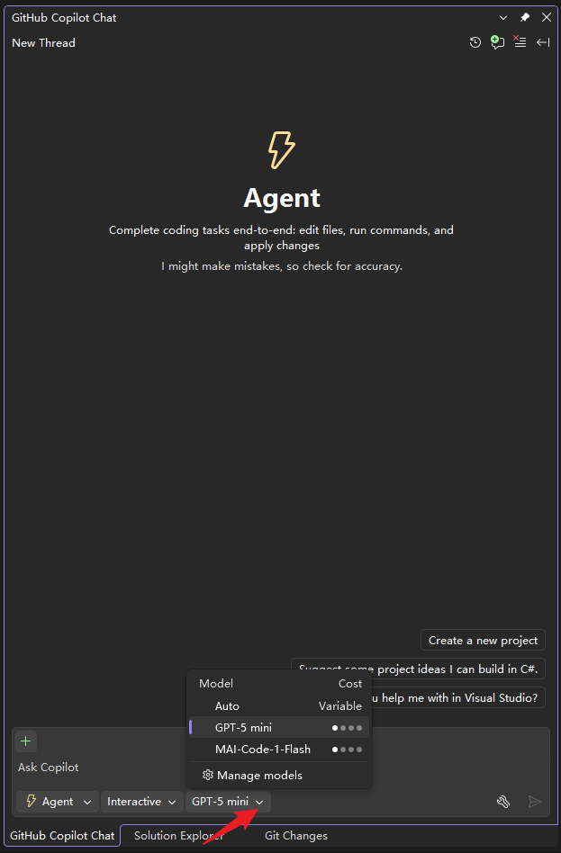
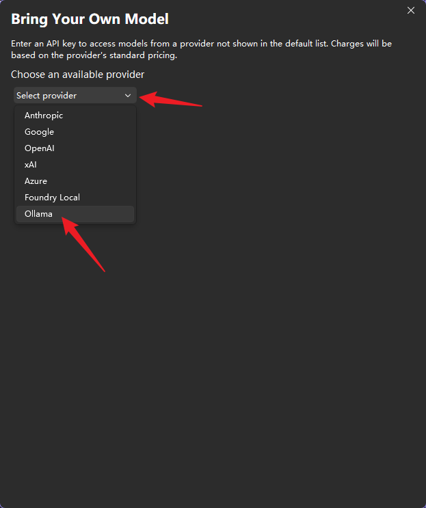
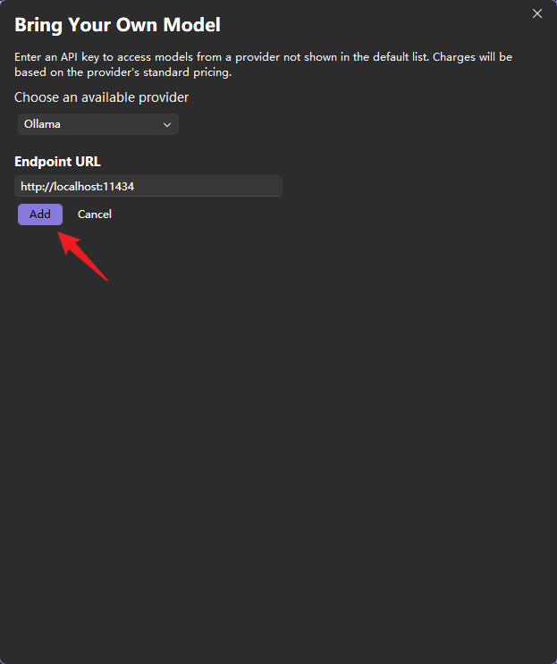
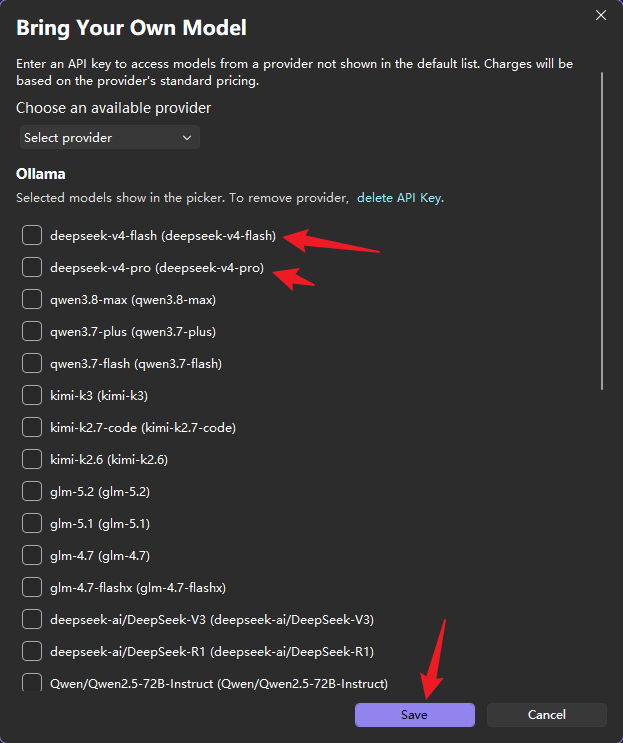
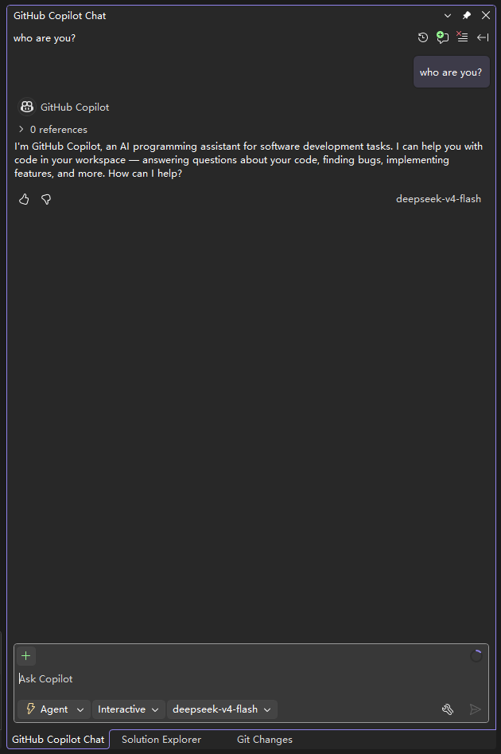

# Visual Studio 接入指南

本服务启动后，对 GitHub Copilot 而言就是一台运行在 `http://localhost:11434` 的本地 Ollama。下面说明如何在 Visual Studio 的 GitHub Copilot Chat 中把模型切到 OllamaHub。

> **VS Code 用户注意（1.127+）**：VS Code 已弃用内置 Ollama 提供程序（[microsoft/vscode#299907](https://github.com/microsoft/vscode/issues/299907)），不要再走原生 Ollama 路径。请改用「语言模型」编辑器里的**自定义端点（Chat Completions）**，端点填 `http://localhost:11434/v1/chat/completions`（OllamaHub 已实现 OpenAI 兼容面）；或安装官方 Ollama 扩展指向本机 `http://localhost:11434`。下面的步骤以 **Visual Studio** 的 Ollama BYO 为例，VS Code 填写方式见文末「VS Code（1.127+）接入」。

## 前置条件

> **Visual Studio 版本要求**：Ollama（Bring Your Own Model）提供程序是 **Visual Studio 2026（18.6.0+）** 才引入的能力，**Visual Studio 2022（17.x）内置的 Copilot Chat 没有 Ollama 选项、也无法手动添加**。若你的 VS 仍是 2022，请先升级到 VS 2026；或改用 VS Code（见文末「VS Code（1.127+）接入」，走自定义端点，不依赖 VS 的 Ollama 提供程序）。

1. 已按 [install-as-service.md](install-as-service.md) 安装并启动 `NewLife.OllamaHub` 服务。
2. 已通过菜单 `p` / `k` / `c` 或命令行完成供应商预设与 API Key 配置。
3. 浏览器访问 `http://localhost:11434/admin` 能看到模型列表，确认服务正常。

## 配置步骤

### 1. 打开模型下拉框

在 Visual Studio 的 **GitHub Copilot Chat** 窗口底部，点击当前模型名称（如 `GPT-5 mini`），选择 **Manage models**。



### 2. 选择 Ollama 提供商

在弹出的 **Bring Your Own Model** 对话框中：

- **Choose an available provider** 下拉选择 **Ollama**。



### 3. 填写本地端点

- **Endpoint URL** 保持默认的 `http://localhost:11434`（即 OllamaHub 默认监听地址）。
- 点击 **Add**。

> 若 OllamaHub 改为其他端口，请填入实际地址，如 `http://localhost:11501`。



### 4. 勾选要使用的模型

OllamaHub 会把 `settings.json` 里配置的模型以 Ollama 格式暴露出来。勾选你需要的模型（如 `deepseek-v4-flash`、`deepseek-v4-pro`），然后点击 **Save**。



### 5. 切换模型开始使用

保存后，再次点击模型下拉框，会在 **Other models** 下看到刚才添加的 Ollama 模型。选中 `deepseek-v4-flash` 等模型后，发送消息即可看到模型实际应答。



## 局域网接入（VS 在另一台机器）

若 VS 与 OllamaHub **不在同一台机器**，VS 的 “Ollama” BYO 提供商对非 localhost 地址**强制要求 HTTPS**，因此走 **`lanHttps`**（端口 `11435`）+ 一张**被 VS 机器信任**的证书即可，无需任何 json 编辑或端口替换：

1. 在 OllamaHub 的 `settings.json` 启用 **`lanHttps`** 并配置证书（见 [configuration.md](configuration.md) 的「证书生成」纯 PowerShell 自签命令，导出 `hub.pfx`/`hub.cer`）：
   ```jsonc
   {
     "lanHttps": {
       "enabled": true,
       "host": "0.0.0.0",
       "port": 11435,
       "certificate": "hub.pfx",
       "certPassword": "证书密码（如有）"
     }
   }
   ```
2. 把证书**导入 VS 所在机器**的「受信任的根证书颁发机构」（双击 `hub.cer` 安装并选对存储位置）。**这是关键一步**：证书未真正受信任时 VS 会校验失败、模型列表取不到。
3. 确认网络可达：在 VS 那台机器执行 `curl https://<OllamaHub服务器IP>:11435/v1/models`（自测连通性可加 `-k`）应返回模型列表；拿不到说明证书未受信任或 11435 入站被防火墙挡。
4. 在 VS 里添加 Ollama，Endpoint URL 直接填 **`https://<OllamaHub服务器IP>:11435`**（注意**不要**带 `/v1`，VS 会自动在其后拼 `/v1/models` 等路径），保存后模型列表即正常加载。

> 证书一旦受信任，VS 通过原生 HTTPS 直连 `lanHttps`，无需 `lanHttp` 或任何配置文件改动。`lanHttp`（明文 11436）仅作为可选的明文备选，并非 VS 接入所必需。
>
> 安全提醒：局域网监听面向同网段，Hub 无鉴权，等同把上游 API Key 暴露给同网段任何人。仅限可信网络 / VPN 使用，并妥善保管 Key。

## 常见问题

- **模型列表为空**：先检查 `/admin` 页面里「模型与用量」是否有模型；若没有，执行 `NewLife.OllamaHub.exe presets deepseek --write` 生成预设，并用 `k` 菜单或 `setkey` 命令填入 API Key。
- **连接失败 / 模型加载不出**：确认服务已启动，且 VS 与 OllamaHub 在同一台机器（或访问 `localhost`）。
- **局域网添加 Ollama 后模型出不来**：几乎都是证书未被 VS 机器真正信任所致（VS 对非 localhost 强制 HTTPS，证书校验失败就拿不到模型）。按上文「局域网接入」生成证书并把公钥导入 VS 机器的「受信任的根证书颁发机构」即可；`lanHttp`（明文 11436）只是可选的明文备选，并非必需。
- **没有 Ollama 选项**：Ollama BYO 提供程序需 **Visual Studio 2026（18.6.0+）**；**Visual Studio 2022（17.x）没有此功能**，下拉里不会出现 Ollama、也无法手动添加，需升级 VS 或改用 VS Code 自定义端点（见文末）。仅升级 GitHub Copilot 扩展但 VS 仍是 2022 仍无效——该能力取决于 Visual Studio 主程序版本。

## VS Code（1.127+）接入

VS Code 1.127 起**内置 Ollama 提供程序已弃用**（[microsoft/vscode#299907](https://github.com/microsoft/vscode/issues/299907)），不再走「模型下拉 → Ollama 提供程序」的原生 Ollama 路径。推荐改用 **自定义端点（Chat Completions）**，OllamaHub 的 OpenAI 兼容面（`/v1/chat/completions` + `/v1/models`）正好对应。

### 方法一：自定义端点（Chat Completions，推荐）

1. 打开 VS Code 的「语言模型」编辑器：模型选择器 → 齿轮图标 **Manage Language Models**，或命令面板 `Chat: Manage Language Models`。
2. 选择 **Add Models** → 选择 **Custom endpoint（自定义端点）**。
3. 供应商类型选 **OpenAI 兼容**，端点 URL 填 `http://localhost:11434/v1/chat/completions`。
4. 在弹出的 `chatLanguageModels.json` 中按 OllamaHub 已配置的模型补充条目（示例，vendor 用 `openai`）：
   ```json
   [
     {
       "name": "OllamaHub",
       "vendor": "openai",
       "models": [
         { "id": "deepseek-v4-flash", "name": "DeepSeek V4 Flash", "url": "http://localhost:11434/v1/chat/completions", "toolCalling": true, "vision": false, "maxInputTokens": 128000, "maxOutputTokens": 8192 },
         { "id": "deepseek-v4-pro",   "name": "DeepSeek V4 Pro",   "url": "http://localhost:11434/v1/chat/completions", "toolCalling": true, "vision": false, "maxInputTokens": 128000, "maxOutputTokens": 8192 }
       ]
     }
   ]
   ```
   > 模型 id 必须与 `settings.json` 中 OllamaHub 暴露的模型名一致（可在 `http://localhost:11434/admin` 查看）。
5. 保存后，模型选择器里即可看到并选用这些模型。

### 方法二：官方 Ollama 扩展

从 VS Marketplace 安装 **Ollama** 官方扩展（Ollama 团队维护），将其指向本机 `http://localhost:11434`（OllamaHub 的 Ollama 原生协议面 `/api/tags`、`/api/chat` 等）。该方式走原生 Ollama 协议，无需自定义端点配置。

> 局域网（VS Code 在另一台机器）时，自定义端点的 URL 改用 `https://<OllamaHub服务器IP>:11435/v1/chat/completions`，并先按上文「局域网接入」生成受信任证书；官方 Ollama 扩展同理指向 `https://<IP>:11435`。
>
> 安全提醒：局域网监听面向同网段，Hub 无鉴权，等同把上游 API Key 暴露给同网段任何人。仅限可信网络 / VPN 使用。
